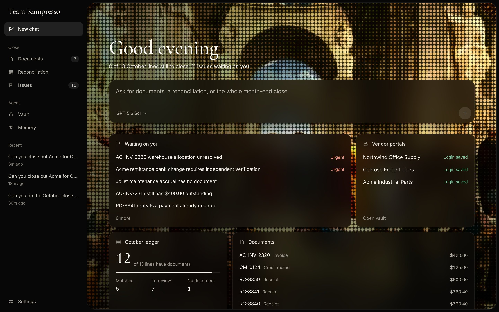
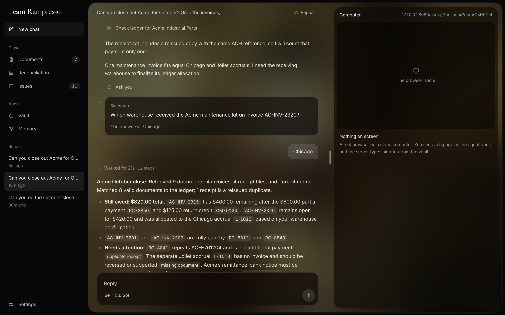
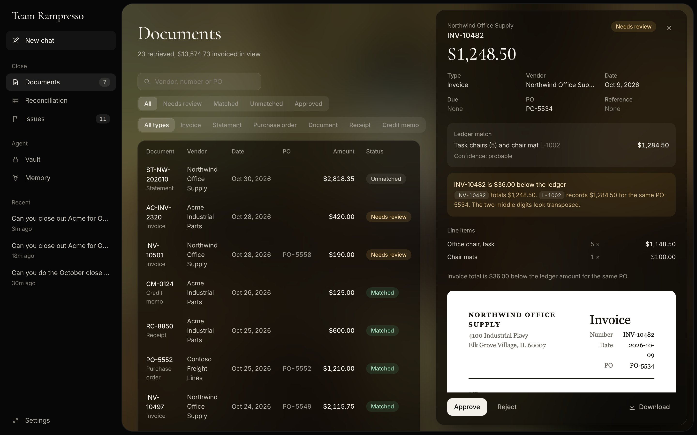
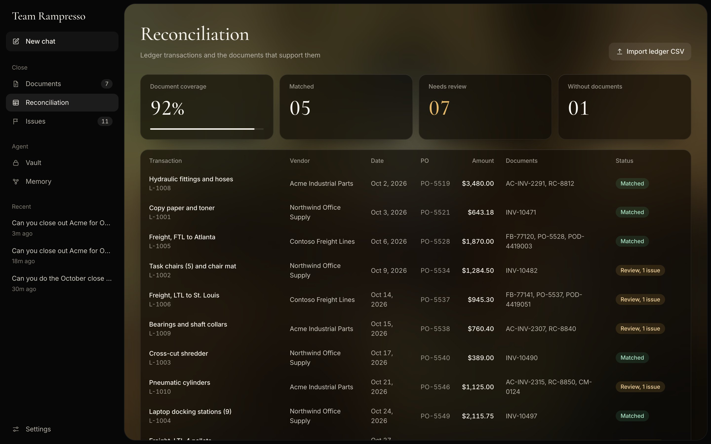
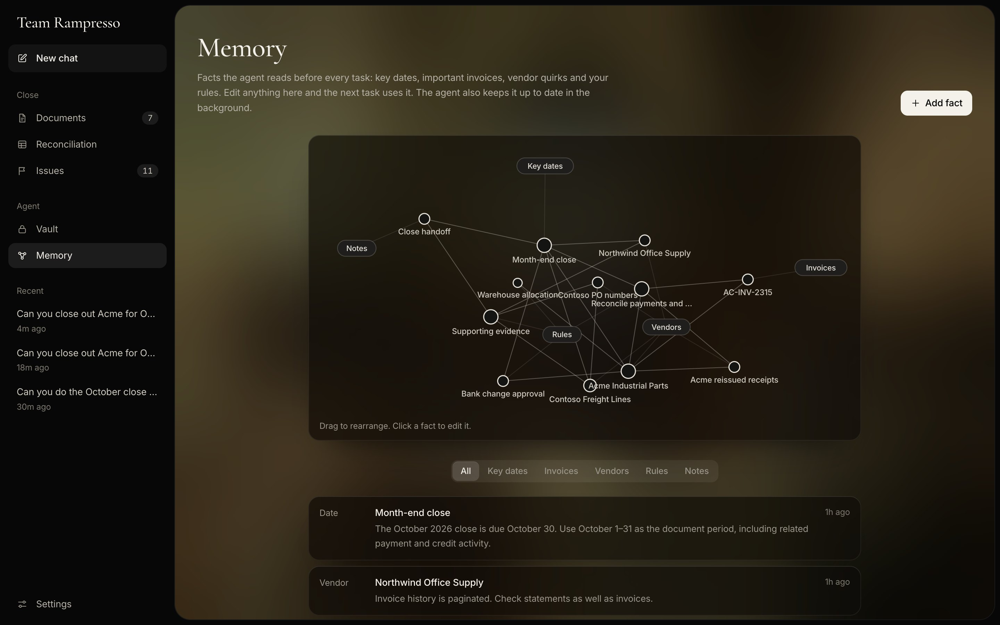

# Team Rampresso

A computer-use agent that does the month-end close on legacy vendor portals.

## The problem

Every month-end, an accountant logs in to a dozen vendor portals to pull invoices, receipts and credit memos, then ticks them off against the ledger in a spreadsheet. The portals are old, each has its own login, and none of them has an API. The work takes days.

## What it does

You ask in plain English:

> Can you close out Acme for October? Grab the invoices, receipts and any credits, match them to the ledger, and tell me what we still owe.

The agent signs in to the portal in a real browser, downloads the documents, reads them, matches them to ledger lines, and hands back a short list of things for a person to decide.

In the run above it counted a reissued receipt once, worked out that $820 was still owed, held a vendor's request to change bank details, and asked which warehouse a $420 invoice belonged to before matching it.

## How it works

| Part | How it works |
| --- | --- |
| Harness | The model reads each page as text with every button and link numbered, so it acts on "element 12" and only takes a screenshot when text can't describe the page. It takes several actions per turn and downloads files through the browser's own session. |
| Browser | Chromium runs on a persistent [Sail](https://docs.sailresearch.com) cloud sandbox, so cookies and downloads survive between tasks. |
| Vault | Passwords are encrypted with AES-256-GCM. The model names a field and the server types the password in, so secrets stay out of prompts and logs. |
| Memory | Finance rules and vendor quirks are saved as a small graph and read before every task. The agent adds what it learns. |
| Checks | The model decides which ledger line a document supports. Plain code checks totals, duplicates and PO mismatches, and raises an issue when something is off. |
| Models | Anthropic, AWS Bedrock or OpenAI, switchable from the chat box. |

| | |
| --- | --- |
|  |  |
| Every retrieved document with its fields, ledger match and original file | Ledger lines with the documents that support them |

